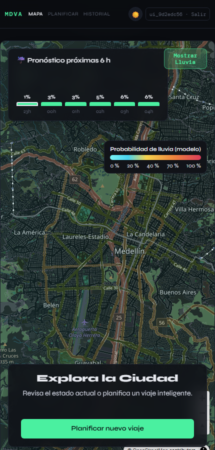
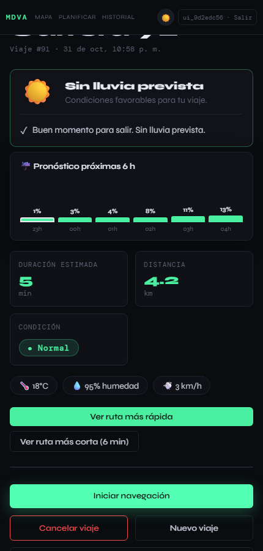
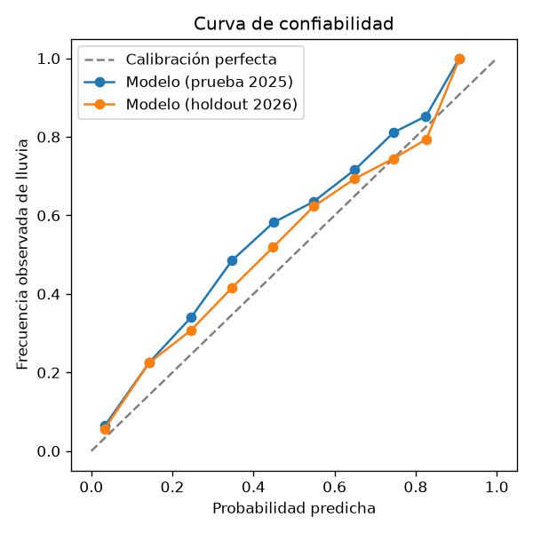
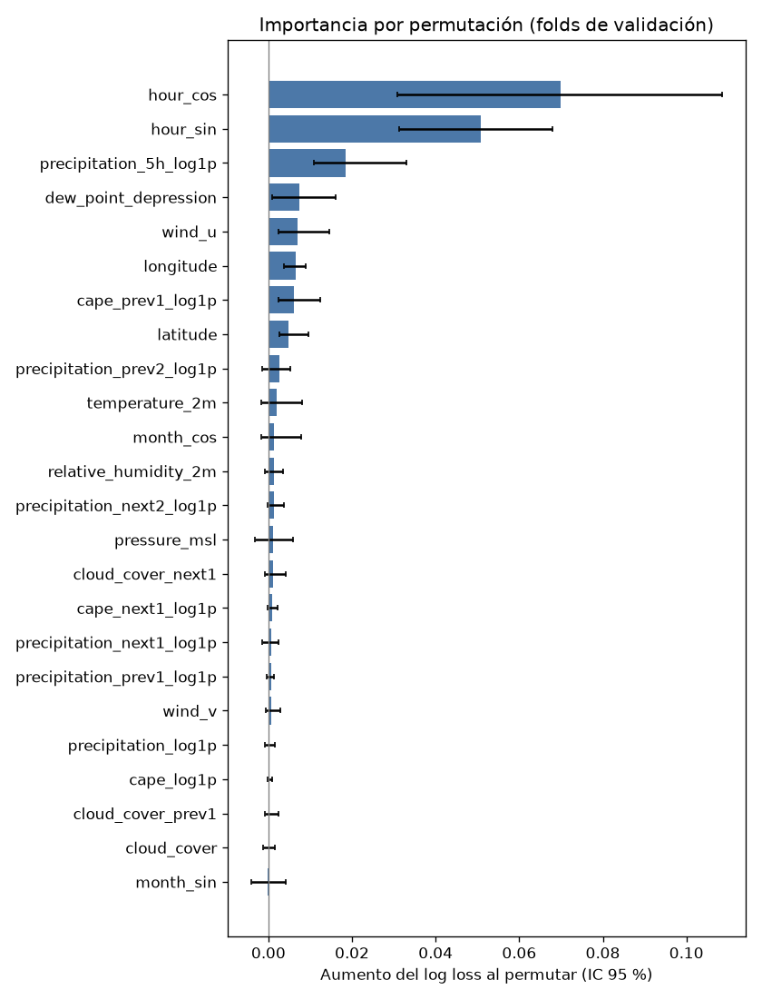
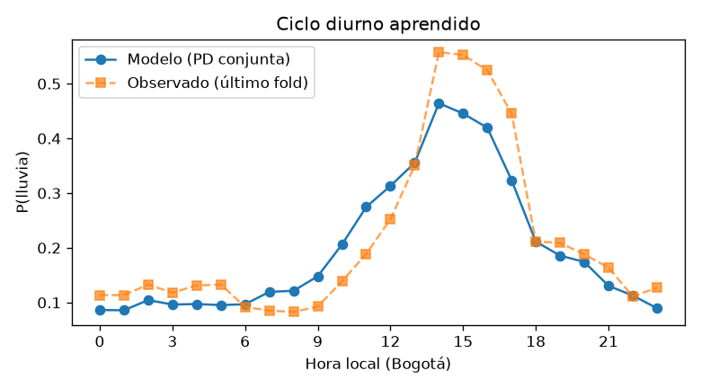

# MDVA — ¿Va a llover en tu ruta? Probabilidad de lluvia calibrada para Medellín

[](https://github.com/nickmen1201/mdva-rain-prediction/actions/workflows/ci-python.yml)
[](https://github.com/nickmen1201/mdva-rain-prediction/actions/workflows/ci-backend.yml)
[](https://github.com/nickmen1201/mdva-rain-prediction/actions/workflows/ci-frontend.yml)


En Medellín la lluvia llega en tormentas de tarde, cortas y muy locales: el pronóstico numérico acierta el día, pero falla la hora y el barrio. **MDVA corrige ese pronóstico con Machine Learning** y entrega, para cada punto del Valle de Aburrá y cada hora, una probabilidad de lluvia **calibrada**; es decir, cuando dice 30 %, llueve cerca del 30 % de las veces. Una aplicación de rutas usa esa probabilidad para avisar antes de salir, ajustar el tiempo de viaje y proponer la ruta más seca.

**Resultado principal:** en datos que ningún paso del desarrollo tocó, el modelo supera al pronóstico de Open-Meteo, la misma fuente que recibe como entrada:

<!-- headline:start -->

| Periodo nunca visto | ROC-AUC: pronóstico → modelo | Brier: pronóstico → modelo | Error de probabilidad |
|---|---|---|---|
| 2026 (holdout, ene–oct) | 0.71 → **0.84** | 0.125 → **0.105** | **−16 %** |
| 2025 (prueba, año completo) | 0.70 → **0.85** | 0.157 → **0.123** | **−21 %** |

<!-- headline:end -->

Supera también a la climatología, a una regresión logística y a la versión anterior del modelo, con intervalos de confianza pareados ([tabla completa](#resultados)). Todo el sistema corre con un solo comando y **sin ninguna API key**.

<table>
  <tr>
    <td width="33%"></td>
    <td width="33%"></td>
    <td width="33%"></td>
  </tr>
  <tr>
    <td align="center"><sub>Probabilidad del modelo sobre el mapa</sub></td>
    <td align="center"><sub>Viaje: alerta, próximas 6 h y rutas</sub></td>
    <td align="center"><sub>Calibración en años nunca vistos</sub></td>
  </tr>
</table>

---

## Qué demuestra este proyecto

| Competencia | Cómo se aplicó aquí |
|---|---|
| **Evaluación sin fuga de información** | Validación cruzada temporal *rolling-origin* (6 folds trimestrales, hueco de 24 h) solo sobre 2022–2024. 2025 y 2026 se evalúan **una sola vez** al final, y un `decision_log` registra qué periodo tocó cada decisión. |
| **Selección de modelos con estadística, no a ojo** | 60 configuraciones de HistGradientBoosting frente a un GAM con *splines* y un bosque aleatorio. Gana el modelo más simple que esté a menos de un error estándar **pareado** del mejor. |
| **Detectar y corregir un error metodológico propio** | La primera versión de la regla de un error estándar ignoraba que los folds son heterogéneos y eligió un modelo **peor en todos los folds**. El error se encontró, se corrigió con la versión pareada, se documentó ([research R3](specs/012-ml-depth/research.md)) y quedó cubierto por un test. |
| **Probabilidades accionables** | Calibración Platt *cross-fitted*: el ECE en desarrollo baja de 0.027 a 0.004. Las curvas de costo muestran que el umbral de alerta (40 %) es casi óptimo y que el umbral empírico coincide con el teórico 1/(1+r). |
| **Interpretabilidad contrastada con la física** | Importancia por permutación con IC, PDP/ICE y ablación por grupos. El modelo aprendió por su cuenta el ciclo diurno de las tormentas (máximo a las 14 h). |
| **Datos y etiqueta defendibles** | La etiqueta (ERA5 ≥ 0.5 mm/h) se validó contra pluviómetros SIATA, con el umbral elegido sin fuga. Los datos pasan por un contrato con *quality gates*, y las descargas son idempotentes con manifiesto SHA-256. |
| **Sin diferencias entre entrenamiento y producción** | Un solo módulo de features (contrato versionado 1.1.0, 24 features) para entrenar y servir, y un test de paridad con diferencia máxima 0. En vivo se consulta la misma fuente, con las mismas variables y unidades. |
| **Del modelo al producto** | API de predicción con validación de contrato (FastAPI). La ruta "más seca" pondera cada tramo de calle por la probabilidad de una grilla espacial del modelo. Model card generada por código, artefactos versionados, CI y Docker Compose. |

---

## Pruébalo en 5 minutos

Requisitos: Docker. No hace falta ninguna API key: el clima viene de Open-Meteo, los mapas de OpenStreetMap y las direcciones de Photon y Nominatim.

```bash
cp .env.example .env          # contraseñas locales de desarrollo
docker compose -f docker-compose.dev.yml up --build
```

Abre <http://localhost:8090>, crea una cuenta y planifica un viaje: escribe un lugar (p. ej. "Universidad de Antioquia") y elige una sugerencia, o toca el mapa. El primer arranque del servicio de rutas descarga el grafo vial del valle (2–10 min); después queda en caché.

Verificación de punta a punta: `make smoke` (API) y `make ui-smoke` (navegador real con Playwright; capturas en [`reports/figures/ui/`](reports/figures/ui/)).

---

## Resultados

<!-- metrics:start -->

**Holdout fresco 2026 (nunca usado en ninguna decisión)** — 2026-01-02 → 2026-10-15, 89,518 horas-estación, llueve en el 16.3 %. IC 95 % por bootstrap en bloques de días.

| Modelo | ROC-AUC | PR-AUC | Brier | BSS vs climatología | ECE |
|---|---|---|---|---|---|
| **rain_classifier 1.1.0** | 0.837 [0.820, 0.856] | 0.525 | 0.1049 | 0.151 | 0.039 |
| rain_classifier 1.0.0 | 0.805 [0.789, 0.824] | 0.488 | 0.1087 | 0.120 | 0.021 |
| Regresión logística | 0.799 [0.779, 0.820] | 0.469 | 0.1098 | 0.111 | 0.017 |
| Climatología (hora × mes) | 0.724 [0.694, 0.754] | 0.362 | 0.1235 | 0.000 | 0.038 |
| Pronóstico crudo de Open-Meteo | 0.714 [0.698, 0.733] | 0.346 | 0.1251 | -0.013 | 0.028 |

Supera con IC pareado (Brier y log loss) a: rain_classifier 1.0.0, Regresión logística, Climatología (hora × mes), Pronóstico crudo de Open-Meteo.

**Prueba 2025** — 2025-01-02 → 2025-12-31, 113,568 horas-estación, llueve en el 21.5 %. IC 95 % por bootstrap en bloques de días.

| Modelo | ROC-AUC | PR-AUC | Brier | BSS vs climatología | ECE |
|---|---|---|---|---|---|
| **rain_classifier 1.1.0** | 0.846 [0.830, 0.860] | 0.615 | 0.1234 | 0.113 | 0.057 |
| rain_classifier 1.0.0 | 0.825 [0.810, 0.840] | 0.581 | 0.1264 | 0.091 | 0.035 |
| Regresión logística | 0.805 [0.789, 0.822] | 0.545 | 0.1323 | 0.049 | 0.031 |
| Climatología (hora × mes) | 0.777 [0.753, 0.797] | 0.505 | 0.1391 | 0.000 | 0.037 |
| Pronóstico crudo de Open-Meteo | 0.702 [0.688, 0.716] | 0.398 | 0.1567 | -0.126 | 0.042 |

Supera con IC pareado (Brier y log loss) a: rain_classifier 1.0.0, Regresión logística, Climatología (hora × mes), Pronóstico crudo de Open-Meteo.

<!-- metrics:end -->

*Tablas generadas por `make readme` desde [`metrics.json`](reports/metrics/rain_classifier/1.1.0/metrics.json); un test impide que se desincronicen del README. Detalle completo en la [model card](models/rain_classifier/1.1.0/model_card.md) y en el [notebook 3.0](notebooks/3.0-nm-evaluacion-y-calibracion.ipynb).*

**Lectura crítica**
- **Calibración fuera de desarrollo.** Dentro de 2022–2024 el ECE es 0.004, pero en 2025 y 2026 sube a 0.04–0.06, por encima de la meta de 0.03, porque la tasa de lluvia cambia entre años (15.6 % en 2024, 21.5 % en 2025). La curva de arriba lo muestra: el modelo subestima un poco la lluvia en los años más lluviosos. Una recalibración periódica con datos recientes es el siguiente paso.
- **Qué significa la etiqueta.** Es reanálisis ERA5 (~25 km), no lluvia medida en un punto: el modelo predice la lluvia "de la zona". Frente a pluviómetros SIATA, la concordancia hora a hora es baja para **cualquier** fuente de malla ([validación externa](reports/metrics/label_validation.json)).
- **Por qué no se usa la persistencia.** "Llueve si llovió la hora anterior" alcanza un Brier similar, pero no es desplegable: en producción no hay una observación de la hora anterior equivalente a la etiqueta.

<p>
  
  
</p>

---

## Cómo funciona

```
Open-Meteo (pronóstico archivado 2022–2026)          ERA5 (etiqueta: lluvia ≥ 0.5 mm/h)
              │                                                 │
              └──────────► mdva.dataset ◄──────────────────────┘   contrato de datos + quality gates
                                │
                         mdva.features   ◄── el mismo código en entrenamiento y en producción
                                │
          mdva.modeling.study: CV rolling-origin · búsqueda · ablación · interpretabilidad · calibración
                                │
          mdva.modeling.train: modelo 1.1.0 + evaluación única en 2025 y 2026 + model card
                                │
     ML API (FastAPI) ◄── Backend (Spring Boot) ◄── Frontend (React + MapLibre)
            ▲                       │
            └── Routing (OSMnx): ruta más rápida, más corta y más seca
```

| Etapa | Qué se hizo | Código |
|---|---|---|
| Datos | Pronósticos archivados de Open-Meteo para 13 estaciones SIATA, 2022–2025, más un holdout 2026 en un archivo aparte. Contrato de datos con *quality gates*. | [`mdva/dataset.py`](mdva/dataset.py), [`mdva/data_contract.py`](mdva/data_contract.py) |
| Features | Variables de la hora, viento en componentes u/v, hora local y mes cíclicos, ventana t−2…t+2 del mismo pronóstico (absorbe errores de *timing*) y ubicación. | [`mdva/features.py`](mdva/features.py), [`docs/features.md`](docs/features.md) |
| Validación | 6 folds trimestrales con ventana creciente y hueco de 24 h; validación espacial dejando fuera una celda ERA5. | [`mdva/modeling/cv.py`](mdva/modeling/cv.py) |
| Modelo | HistGradientBoosting elegido con la regla de un error estándar pareada entre 60 configuraciones y dos familias de referencia. | [`mdva/modeling/search.py`](mdva/modeling/search.py) |
| Análisis | Permutación con IC, PDP/ICE, ciclo diurno, ablación, curva de aprendizaje, errores por segmento y curvas de costo. | [`mdva/modeling/analysis.py`](mdva/modeling/analysis.py) |
| Evaluación | Bootstrap en bloques de días, diferencias pareadas frente a cada baseline y `decision_log`. | [`mdva/modeling/train.py`](mdva/modeling/train.py) |

### Reproducir el modelo

Requisitos: [uv](https://docs.astral.sh/uv/) y `make`. Python 3.11 con versiones fijadas en `uv.lock`; semillas fijas.

```bash
make requirements     # entornos de los 3 proyectos Python
make data             # dataset 2022–2025 desde Open-Meteo
make data-holdout     # holdout 2026 (archivo aparte)
make study            # CV, búsqueda, ablación e interpretabilidad (~1 h en 12 núcleos)
make train            # modelo 1.1.0 + evaluación única en 2025 y 2026 + model card
make notebook         # notebook 3.0, que solo lee reports/
make readme           # cifras de este README
make lint test        # ruff + pytest (incluye estudio → entrenamiento de punta a punta con datos sintéticos)
```

Cada corrida de entrenamiento queda registrada en `reports/runs/` (commit, huella del dataset, parámetros y métricas).

### Servicios

| Servicio | Tecnología | Puerto | Rol |
|---|---|---|---|
| ML API | FastAPI | 8081 | `POST /v2/predict` y `/v2/predict/batch`: valida la entrada contra el contrato de features y devuelve la probabilidad calibrada y el nivel de alerta |
| Routing | FastAPI + OSMnx + NetworkX | 8000 | Rutas sobre el grafo OSM del valle con tiempos por tipo de vía; ruta más seca con una grilla espacial de probabilidad |
| Backend | Spring Boot 3 + Java 21 + PostgreSQL | 8080 | Viajes, alertas, monitoreo en ruta, clima en vivo y direcciones (sugerencias con Photon, búsqueda y dirección de un punto con Nominatim) |
| Frontend | React 19 + MapLibre GL | 8090 | Mapa de probabilidad, planificación, resultado y navegación |
| Base de datos | PostgreSQL 16 + Flyway | 5436 | Usuarios, viajes, paradas y alertas |

### Estructura (Cookiecutter Data Science v2)

```
mdva/                 paquete de ciencia de datos: dataset, contrato, features, modelado, reportes
services/ml_api/      servicio de predicción (consume mdva)
services/routing_api/ servicio de rutas
apps/backend/         Spring Boot
apps/frontend/        React + MapLibre
models/               modelos versionados con metadata y model card
reports/              métricas, estudio, figuras y registro de corridas (generados por código)
notebooks/            exploración (1.0) y narración de la evaluación (3.0)
specs/                especificación, plan, contratos y verificación de cada etapa
tests/                pytest del paquete y pruebas de punta a punta del stack
```

Cada etapa del trabajo tiene su especificación, su plan y su verificación registrada en [`specs/`](specs/) (Spec-Driven Development), bajo una [constitución de ingeniería](.specify/memory/constitution.md). La CI en GitHub Actions corre ruff, pytest y el smoke del ML API (Python), los tests de Gradle (Backend), ESLint, vitest y el build (Frontend), además de un escaneo de secretos.

---

## Limitaciones

- La etiqueta es reanálisis (ERA5, ~25 km), no un pluviómetro.
- 13 estaciones en 5 celdas: hay muchas menos observaciones independientes que filas; por eso los intervalos remuestrean días completos.
- La calibración se degrada cuando cambia la tasa anual de lluvia; falta una recalibración periódica.
- Los tiempos de viaje usan velocidades por tipo de vía de OSM, sin tráfico en vivo.

## Autoría

MDVA nació como proyecto de curso (2026-1) de **Camilo Ardila, Santiago Martínez, Nicolás Meneses y Luis Ángel Seoanes**: la primera versión de la aplicación (Backend, Frontend, base de datos y un prototipo de modelo) es trabajo del equipo.

Esta versión es el trabajo individual de **Nicolás Meneses**, que rehízo:
- todo el componente de ciencia de datos: dataset reproducible, validación de la etiqueta, contrato de features, estudio de modelado, calibración, evaluación y model card;
- los servicios de ML y de rutas (contratos, una sola señal de lluvia, ruta más seca espacial);
- la migración a servicios gratuitos (Open-Meteo, OpenStreetMap, MapLibre), la reestructuración del repositorio y la CI.
