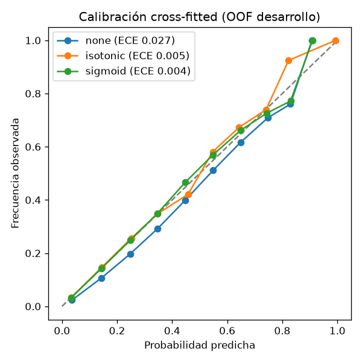

# MDVA — Predicción horaria de lluvia para la movilidad en el Valle de Aburrá

[](https://github.com/nickmen1201/mdva-rain-prediction/actions/workflows/ci-python.yml)
[](https://github.com/nickmen1201/mdva-rain-prediction/actions/workflows/ci-backend.yml)
[](https://github.com/nickmen1201/mdva-rain-prediction/actions/workflows/ci-frontend.yml)

Clasificador **calibrado** de probabilidad de lluvia por hora y por punto para Medellín y su área metropolitana, construido sobre pronósticos numéricos gratuitos (Open-Meteo), evaluado con validación temporal honesta y servido en una aplicación de planificación de viajes (rutas, alertas y navegación) que corre completa **sin ninguna API key**.

> El centro de este repositorio es el **proceso de Machine Learning**: dataset reproducible con contratos de datos, una sola definición de features para entrenamiento e inferencia, búsqueda de hiperparámetros con validación cruzada *rolling-origin*, interpretabilidad contrastada con la física, calibración *cross-fitted*, análisis de decisión para los umbrales y una evaluación final única en un periodo nunca visto (2026).

---

## Resultados

<!-- metrics:start -->

**Holdout fresco 2026 (nunca usado en ninguna decisión)** — 2026-01-02 → 2026-10-15, 89,518 horas-estación, llueve en el 16.3 %. IC 95 % por bootstrap en bloques de días.

| Modelo | ROC-AUC | PR-AUC | Brier | BSS vs climatología | ECE |
|---|---|---|---|---|---|
| **rain_classifier 1.1.0** | 0.837 [0.820, 0.856] | 0.525 | 0.1049 | 0.151 | 0.039 |
| rain_classifier 1.0.0 | 0.805 [0.789, 0.824] | 0.488 | 0.1087 | 0.120 | 0.021 |
| Regresión logística | 0.799 [0.779, 0.820] | 0.469 | 0.1098 | 0.111 | 0.017 |
| Climatología (hora × mes) | 0.724 [0.694, 0.754] | 0.362 | 0.1235 | 0.000 | 0.038 |
| Pronóstico crudo de Open-Meteo | 0.714 [0.698, 0.733] | 0.346 | 0.1251 | -0.013 | 0.028 |

Supera con IC pareado (Brier y log loss) a: rain_classifier 1.0.0, Regresión logística, Climatología (hora × mes), Pronóstico crudo de Open-Meteo.

**Prueba 2025** — 2025-01-02 → 2025-12-31, 113,568 horas-estación, llueve en el 21.5 %. IC 95 % por bootstrap en bloques de días.

| Modelo | ROC-AUC | PR-AUC | Brier | BSS vs climatología | ECE |
|---|---|---|---|---|---|
| **rain_classifier 1.1.0** | 0.846 [0.830, 0.860] | 0.615 | 0.1234 | 0.113 | 0.057 |
| rain_classifier 1.0.0 | 0.825 [0.810, 0.840] | 0.581 | 0.1264 | 0.091 | 0.035 |
| Regresión logística | 0.805 [0.789, 0.822] | 0.545 | 0.1323 | 0.049 | 0.031 |
| Climatología (hora × mes) | 0.777 [0.753, 0.797] | 0.505 | 0.1391 | 0.000 | 0.037 |
| Pronóstico crudo de Open-Meteo | 0.702 [0.688, 0.716] | 0.398 | 0.1567 | -0.126 | 0.042 |

Supera con IC pareado (Brier y log loss) a: rain_classifier 1.0.0, Regresión logística, Climatología (hora × mes), Pronóstico crudo de Open-Meteo.

<!-- metrics:end -->

*Tabla generada por `make readme` desde [`reports/metrics/rain_classifier/1.1.0/metrics.json`](reports/metrics/rain_classifier/1.1.0/metrics.json); un test impide que se desincronice. Detalle completo en la [model card](models/rain_classifier/1.1.0/model_card.md) y en el [notebook 3.0](notebooks/3.0-nm-evaluacion-y-calibracion.ipynb).*

**Lectura honesta**
- El modelo mejora de forma significativa a todos los baselines desplegables, también en 2026. La persistencia ("llueve si llovió la hora anterior") tiene un Brier similar, pero **no es desplegable**: en producción no hay una observación de la hora anterior equivalente a la etiqueta.
- La calibración *cross-fitted* (Platt) bajó el ECE de 0.027 a 0.004 dentro de desarrollo, pero en 2025 y 2026 el ECE (0.04–0.06) supera la meta de 0.03: la tasa de lluvia cambia entre años (15.6 % en 2024, 21.5 % en 2025). Es una limitación documentada, no oculta.
- La etiqueta es reanálisis ERA5 (~25 km), no lluvia medida: frente a pluviómetros SIATA la concordancia horaria es baja para **cualquier** fuente de malla ([validación externa](reports/metrics/label_validation.json)). El modelo predice lluvia "de la zona", no de un punto exacto.

---

## El problema

Medellín tiene lluvias convectivas de tarde, muy locales y difíciles de pronosticar a la hora exacta. La aplicación ajusta el tiempo de viaje y emite alertas (VERDE < 40 %, AMARILLO 40–70 %, ROJO > 70 %) según la probabilidad de lluvia en el origen. Para que esas alertas sean útiles, la probabilidad tiene que estar **calibrada** y el modelo tiene que superar a lo que ya ofrece el pronóstico numérico.

## Método

| Etapa | Qué se hizo | Dónde |
|---|---|---|
| Datos | Pronósticos archivados de Open-Meteo (la misma fuente que se consulta en vivo) para 13 estaciones SIATA, 2022–2025; etiqueta: precipitación ERA5 ≥ 0.5 mm/h (umbral calibrado contra pluviómetros sin fuga). Contrato de datos con *quality gates*, descargas idempotentes con manifiesto SHA-256. Holdout 2026 en archivo aparte | `mdva/dataset.py`, `mdva/data_contract.py`, `make data`, `make data-holdout` |
| Features | **Un solo módulo** para entrenamiento e inferencia (contrato versionado 1.1.0, 24 features): variables de la hora, viento en componentes u/v, codificación cíclica de hora local y mes, **ventana t−2…t+2 del mismo pronóstico** (absorbe errores de *timing*) y ubicación. Test de paridad entrenamiento/inferencia con diferencia máxima 0 | `mdva/features.py`, `docs/features.md` |
| Validación | CV *rolling-origin*: 6 folds trimestrales 2023–2024, ventana creciente, hueco de 24 h. 2025 y 2026 fuera de toda decisión | `mdva/modeling/cv.py` |
| Selección de features | Aporte marginal de cada grupo candidato (> 1 EE pareado) y **validación espacial** (entrenar sin una celda ERA5, evaluar en ella) para la ubicación | `study.json` → `feature_candidates`, `spatial_cv` |
| Modelo | 60 configuraciones aleatorias de HistGradientBoosting + logística con *splines* (GAM) + bosque aleatorio; elección con la **regla de un error estándar pareada** | `mdva/modeling/search.py` |
| Interpretabilidad | Importancia por permutación con IC, PDP/ICE, ciclo diurno aprendido (máximo a las 14 h, como las tormentas de la tarde), ablación por grupos y curva de aprendizaje | `mdva/modeling/analysis.py` |
| Calibración y umbrales | Calibración *cross-fitted* (cada fold con los anteriores); curvas de costo: el umbral óptimo empírico coincide con 1/(1+r), y 0.40 es casi óptimo para r ≈ 1–2 | `mdva/modeling/calibration.py` |
| Evaluación | Una sola vez en 2025 y 2026 frente a climatología, pronóstico crudo, logística y el modelo anterior; IC por bootstrap en bloques de días y diferencias pareadas; registro de qué periodo tocó cada decisión | `mdva/modeling/train.py`, `metrics.json` → `decision_log` |

**Un hallazgo del proceso.** La primera versión de la regla de un error estándar usaba el EE de la media del log loss entre folds. Como los trimestres tienen tasas de lluvia muy distintas, ese EE era enorme (≈ 0.04) y la regla eligió un modelo peor **en todos los folds**. La versión correcta es pareada: el EE de la diferencia por fold frente al mejor. Está documentado en [`specs/012-ml-depth/research.md`](specs/012-ml-depth/research.md) (R3) y cubierto por un test.




---

## Reproducir

Requisitos: [uv](https://docs.astral.sh/uv/) y `make` (o los comandos equivalentes del `Makefile`). Todo el pipeline usa Python 3.11 con versiones fijadas en `uv.lock`.

```bash
make requirements     # entornos de los 3 proyectos Python desde sus lockfiles
make data             # dataset 2022–2025 desde Open-Meteo (~30 s con la caché de descargas)
make data-holdout     # holdout 2026 (archivo aparte)
make study            # estudio de modelado: CV, búsqueda, ablación, interpretabilidad (~1 h en 12 núcleos)
make train            # modelo final 1.1.0 + evaluación única en 2025 y 2026 + model card
make notebook         # notebook 3.0 ejecutado leyendo solo reports/
make readme           # tabla de resultados de este README
make lint test        # ruff + pytest (incluye un estudio + entrenamiento de punta a punta con datos sintéticos)
```

Semillas fijas; cada corrida de entrenamiento queda registrada en `reports/runs/` (commit, huella del dataset, parámetros y métricas).

## Producto

El modelo se sirve en una aplicación de cinco servicios, que corre completa con `docker compose -f docker-compose.dev.yml up --build` (o `make up`) y **sin ninguna API key**:

| Servicio | Tecnología | Puerto | Rol |
|---|---|---|---|
| ML API | FastAPI | 8081 | `POST /v2/predict` y `/v2/predict/batch`: valida la entrada contra el contrato de features (422 con Problem Details) y devuelve probabilidad calibrada y nivel de alerta |
| Routing | FastAPI + OSMnx + NetworkX | 8000 | Rutas sobre el grafo OSM del valle con tiempos por tipo de vía; ruta "más seca" ponderando cada arista por la probabilidad de lluvia de una grilla espacial del modelo |
| Backend | Spring Boot 3 + Java 21 + PostgreSQL | 8080 | Viajes, alertas, monitoreo en ruta, clima (Open-Meteo) y geocodificación (Nominatim, ≤ 1 req/s con caché) |
| Frontend | React 19 + MapLibre GL | 8090 | Mapa con heatmap de probabilidad (escala fija), planificación, navegación 3D |
| Base de datos | PostgreSQL 16 (Flyway) | 5436 | Usuarios, viajes, paradas, alertas |

Verificación de punta a punta: `make smoke` (API) y `make ui-smoke` (navegador real con Playwright; capturas en `reports/figures/ui/`).

```
Frontend ──▶ Backend ──▶ Routing ──▶ ML API ◀── Open-Meteo (pronóstico en vivo)
                │                        ▲
                ├──▶ ML API ─────────────┘    (misma fuente, mismas variables y unidades que el entrenamiento)
                └──▶ Nominatim (direcciones)
```

## Estructura (Cookiecutter Data Science v2)

```
mdva/                 paquete de ciencia de datos: dataset, contrato de datos, features, modelado, reportes
  modeling/           cv, search, analysis, calibration, study, train, evaluate, predict, model_card
services/ml_api/      servicio de predicción (consume mdva)
services/routing_api/ servicio de rutas (DDD)
apps/backend/         Spring Boot
apps/frontend/        React + MapLibre
models/               artefactos versionados (< 5 MB) con metadata.json y model_card.md
reports/              métricas, estudio, figuras y registro de corridas (generados por código)
notebooks/            exploración (1.0) y narración del modelado (3.0)
specs/                especificaciones por etapa (Spec-Driven Development) con plan, contratos y verificación
docs/                 contrato de features, informe técnico y manuales
tests/                pytest del paquete y pruebas de punta a punta del stack
```

## Cómo se trabajó

El proyecto se refactorizó con **Spec-Driven Development**: cada cambio pasó por especificación → aclaraciones → plan → contratos → tareas → análisis de consistencia → implementación → verificación registrada, bajo una [constitución](.specify/memory/constitution.md) de ingeniería (reproducibilidad, contratos, evaluación honesta, sin datos inventados) y un [charter](.specify/memory/charter.md) con el diagnóstico de partida. Cada carpeta de [`specs/`](specs/) documenta una etapa, desde la reestructuración del repositorio (001) hasta la profundidad de ML (012).

CI en GitHub Actions: ruff + pytest + smoke del ML API (Python), Gradle test (Backend), ESLint + vitest + build (Frontend) y escaneo de secretos.

## Autoría

MDVA nació como proyecto de curso (2026-1) de **Camilo Ardila, Santiago Martínez, Nicolás Meneses y Luis Ángel Seoanes**: la primera versión de la aplicación (Backend, Frontend, base de datos y un prototipo de modelo) es trabajo del equipo.

Este repositorio es la versión de portafolio de **Nicolás Meneses**, que rehízo de forma individual:
- todo el componente de ciencia de datos: dataset reproducible, etiqueta validada contra pluviómetros, contrato de features, estudio de modelado, calibración, evaluación y model card;
- los servicios de ML y de rutas (contratos, señal de lluvia única, ruta más seca espacial);
- la migración del producto a servicios gratuitos (Open-Meteo, OSM/Nominatim, MapLibre), la reestructuración CCDS v2 y la CI.

## Limitaciones

- La etiqueta es reanálisis (ERA5, ~25 km): el modelo aprende la lluvia de la celda, no la de un pluviómetro.
- 13 estaciones en 5 celdas: muchas menos observaciones independientes que filas (por eso los IC remuestrean días completos).
- La tasa de lluvia varía entre años y degrada la calibración fuera de desarrollo; una recalibración periódica con datos recientes es el siguiente paso natural.
- Los tiempos de viaje usan velocidades por tipo de vía de OSM; no hay tráfico en vivo (no existe una fuente gratuita).

